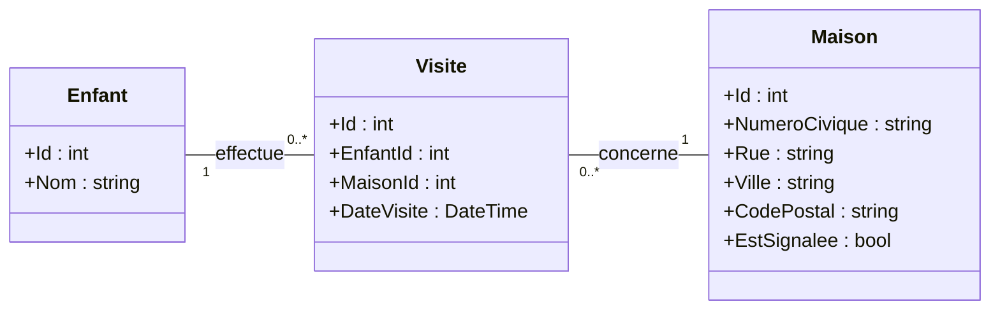

## Description de l'application
HalloWinUI est une application WinUI qui aide à organiser la tournée d’Halloween d’un quartier. Elle permet de gérer la liste des maisons à visiter :

- afficher les maisons sous forme de cartes, avec leur adresse ;
- ajouter une maison à l’aide d’un formulaire (numéro, rue, ville, code postal) ;
- supprimer une maison, après confirmation;
- signaler une maison jugée non sécuritaire, ce qui met à jour son statut.
- [d'autres fonctionnalités seront ajoutés pour aider à pratique la matière qui sera vue].

## Instructions
1. Faire une copie du gabarit (cliquez sur Use this template).
2. L'architecture MVVM doit être respectée (modèles, vues et modèles de vues, ainsi que l'utilisation de la liaison de données entre les vues et les modèles de vues).
3. Corriger et compléter le code de façon à :
	- Afficher toutes les informations des maisons.
	- Implémenter l'ajout d'une maisons, en entrant ses informations dans le formulaire, celle-ci doit apparaitre dans la grille des maisons.
	- Implémenter la suppression d'une maison en la séléctionnant, celle-ci doit disparaître de la grille des maisons. Vous devez ajouter une confirmation de suppression. Voir les notes de cours https://projets420.gitbook.io/asp.net/420-3p3-dev.-applications-windows/winui/elements-supplementaires#afficher-une-boite-de-dialogue-pour-confirmer-une-action
	- Afficher un statut "Signalé" ou "Sécuritaire" sur la carte, selon si on coche sur la case Signaler ou non.

## Diagrammes de classes

### Diagramme conceptuel
Le diagramme conceptuel présente les concepts de l'application. Un enfant peut visiter plusieurs maisons, et une maison peut être visitée par plusieurs enfants. La visite, qui a sa propre date, est une classe d'association.

### Diagramme de conception
Le diagramme de conception présente les classes telles qu'elles sont codées. La classe d'association `Visite` devient une classe ordinaire, et la relation plusieurs-à-plusieurs est remplacée par deux relations un-à-plusieurs.

